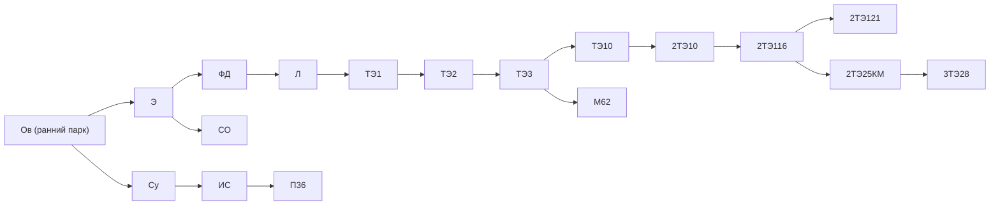
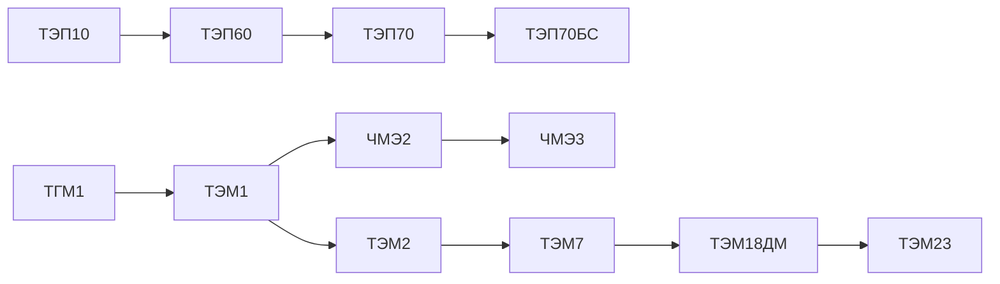
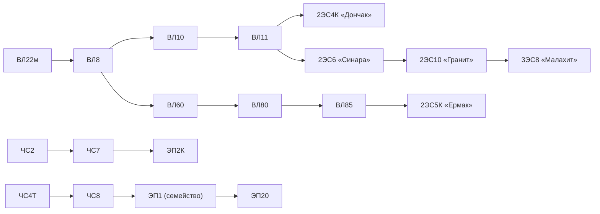
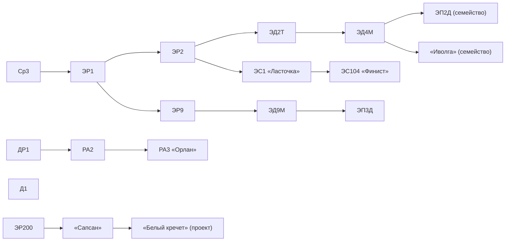

# 11в. Дерево исследований железнодорожной техники (1900–2030)

**Статус:** предварительная схема для «Минтранса». Узлы — конкретные узнаваемые модели/семейства; связи — игровые возможности исследования, а **не автоматически историческая преемственность**. Основа интерфейса — дерево техники World of Tanks. В коде эта механика ещё не реализована.

## Правила исследования

- Несколько параллельных веток могут развиваться независимо, ветки могут расходиться и пересекаться.
- Игроку достаточно одного исследованного предшественника (условие **ИЛИ**), если модель имеет несколько входящих связей. Отдельные случаи с обязательными совместными условиями решим позже.
- Направление ветки подсказывает историческую специализацию, но **не диктует роль**: применять технику можно по характеристикам, тяговым и инфраструктурным ограничениям.
- Старые исследованные локомотивы сохраняются как бюджетные альтернативы; не нужны три новые серии в каждом десятилетии.
- Год модели — ориентир самой ранней технической доступности, но не бесплатное и автоматическое открытие покупки.
- Кампания по текущему документу начинается в 1950 году и заканчивается около 2000 года. **Исследовательский каталог продлён до 2030**, однако продление самой кампании отдельно не утверждено. Старт 1950 года получает предысторию исследований готовой.
- Российские и постсоветские модели после 1991 года — исторические прототипы для альтернативного СССР. Это не утверждение, будто в реальности их выпускал СССР.
- Ветка «Белого кречета» помечена как прогнозная; не представлять проект как уже серийный поезд.

## Как открываются модели

Граф задаёт **допустимые связи исследований**, но не отдельные научные школы. Исследование оплачивается **общей научной производительностью** всех НИИ и КБ, которые игрок построил и улучшил в городах/на заводах. Можно распределять мощности между несколькими проектами одновременно. Поздние модели стоят больше исследовательских очков **и требуют подходящего уровня научной компетентности**: хотя бы одно действующее НИИ или КБ должно достичь минимального уровня, назначенного конкретной модели. Сто НИИ низкого уровня не могут заменить это условие, но их суммарная мощность ускоряет исследование после его выполнения. Изученная модель затем доступна к закупке при соблюдении инфраструктурных требований. Подробнее: [НИИ и заводские КБ](14a_research_infrastructure.md). **Реализация дерева и научной инфраструктуры пока отсутствует.**

## Паровозы и грузовые магистральные тепловозы

## Пассажирские и маневровые тепловозы

## Грузовые и пассажирские электровозы

## Моторвагонный состав, дизель-поезда и высокоскоростное движение

## Перекрёстные исследовательские переходы

Пунктирные переходы будем добавлять в игровой интерфейс как альтернативный путь к уже существующему узлу. Приведённые ниже рёбра также включены в [JSON графа](11c_railway_research_tree.json). **Это предложенные игровые связи**, а не буквальные замены исторических машин.

| От модели | К модели | Игровая логика |
|---|---|---|
| ИС | ЭР1 | Переход от пассажирской паровой тяги к пригородным электричкам (игровая, не историческая замена). |
| СО | ТЭ2 | Массовая грузовая тяга → ранний магистральный дизель. |
| ФД | ВЛ8 | Тяжёлые поезда → электрификация грузовых магистралей. |
| ТЭ3 | ВЛ10 | Грузовые тепловозы → грузовая электротяга постоянного тока. |
| ВЛ10 | ВЛ80 | Альтернативная школа электрификации переменного тока. |
| ТЭ3 | ВЛ60 | Дизельная магистраль → электрическая магистраль. |
| М62 | ТЭП70 | От универсальной дизельной тяги к современной пассажирской. |
| ТЭП70 | ЭП2К | Пассажирские магистрали: дизель → электричество. |
| ЭП2К | ЭП20 | Переход к двухсистемному пассажирскому локомотиву. |
| ТЭМ2 | ЧМЭ3 | Выбор альтернативной школы маневровой техники. |
| ЧМЭ3 | ТЭМ7 | Тяжёлые манёвры через другую школу. |
| ТЭМ2 | ТЭМ18ДМ | Развитие современного парка без обязательного ТЭМ7. |
| 2ТЭ121 | 3ТЭ28 | Поздняя тяжёлая дизельная тяга. |
| ВЛ80 | 2ЭС5К «Ермак» | Возможность выйти на «Ермак», минуя ВЛ85. |
| 2ЭС6 «Синара» | 3ЭС8 «Малахит» | «Малахит» как альтернатива прохождению через «Гранит». |
| Д1 | РА2 | От региональных дизель-поездов к рельсовым автобусам. |
| ЭП2Д (семейство) | ЭС104 «Финист» | Современная региональная тяга через пригородную ветку. |
| ЭР2 | ЭР200 | От массовой электрички к высокоскоростной линии. |
| ЧС7 | ЭР200 | Скоростная пассажирская школа. |
| ЭД4М | ЭС1 «Ласточка» | Альтернатива дальнейшему обычному пригородному развитию. |

## Принципы баланса, которые нужно проверить

1. Исследования должны давать выбор между дешёвой старой, универсальной и дорогой мощной техникой за счёт уже открытого парка, а не искусственно навязанной тройки в каждом десятилетии.
2. Маневровые локомотивы не запрещены на магистрали, но при перевозках на большие расстояния проигрывают по постоянной мощности, скорости, автономности и стоимости перевозки груза.
3. Мощная пассажирская машина может возить грузы, если хватает тяги и совместимости; её историческое назначение не является логической блокировкой.
4. Если игроку нужны только тяжёлые грузовые перевозки, путь исследований не должен требовать освоения всех электричек и пассажирских локомотивов.
5. Параметры цены исследований, тяги, разгона, обслуживания, топлива и календарных ограничений требуют отдельного баланса.

## Что уже проверено автоматически

- 68 различных узлов, 67 основных и 20 перекрёстных рёбер.
- Все связи ведут к существующим моделям, нет дублирующих рёбер, циклов, недостижимых узлов от исходного паровоза и переходов к более ранней дате модели.
- Эти тесты гарантируют логическую согласованность графа, но не историческую точность каждой предложенной связи.

## Источники поздних моделей

- [«Малахит» 2ЭС8/3ЭС8, производитель](https://ulkm.ru/products/gruzovye-elektrovozy/malakhit/).
- [3ТЭ28, Трансмашхолдинг](https://tmholding.ru/media/events/34233.html).
- [ТЭМ23, производитель](https://tmholding.ru/products/promyshlennye-manevrovye/manevrovyy-teplovoz-tem23/).
- [ЭП2Д и замена семейства ЭД4М, ТМХ](https://tmholding.ru/media/events/5212.html).
- [ЭП3Д, ТМХ](https://tmholding.ru/media/events/5235.html).
- [ЭС104 «Финист», данные эксплуатации](https://rostransnadzor.gov.ru/news/5506).
- [«Белый кречет», прогноз поставок до 2030 года, Минтранс](https://mintrans.gov.ru/press-center/branch-news/5856).
