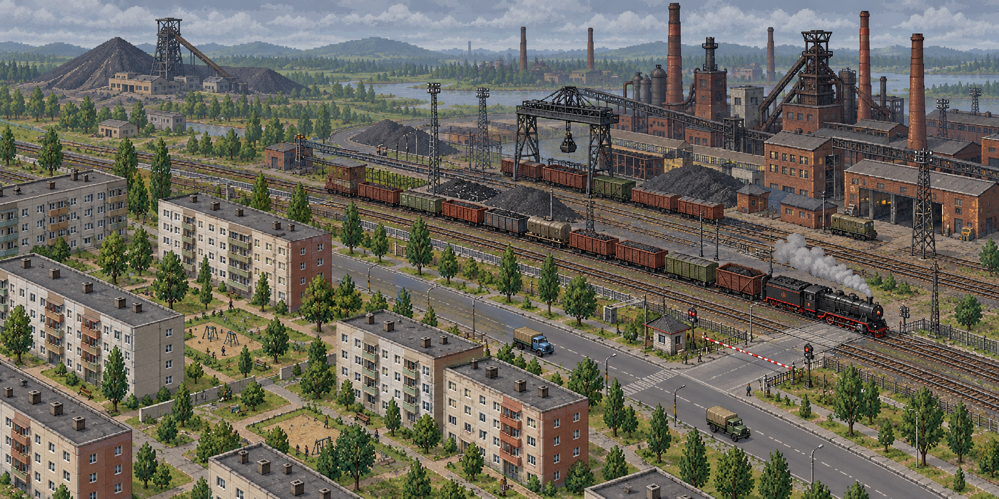
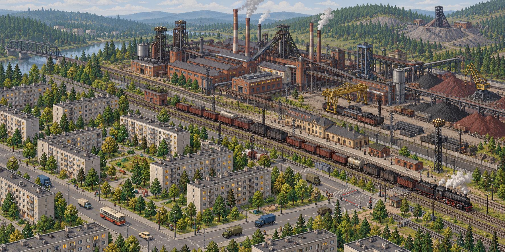

# 18. Визуальный стиль: индустриальная советская республика

**Статус:** визуальное направление и два концепт-арта утверждены. Игра остаётся читаемой изометрической 2D-стратегией; точный способ рисования игровых спрайтов и их размер проверим на пробных ассетах.

## Главный образ

**Живой город-завод в действующей советской республике.** Через город идут трамвайные и автомобильные улицы, рядом тянутся железнодорожные пути, за жилыми кварталами видны цеха, трубы и склады. Поезда и грузовики связывают шахты, комбинат и город. На карте чувствуется масштаб государства и повседневный труд, а не заброшенность.

Пять опорных впечатлений:

1. **Масштаб индустрии:** протяжённые цеха, высокие трубы, подъездные пути, конвейеры, градирни и линии электропередачи.
2. **Планировка города:** кварталы типовых домов, широкие улицы, дворы, общественные здания, остановки и зелёные полосы между жильём и производством.
3. **Материальность:** бетон, красный кирпич, потемневшая сталь, ржавчина на рабочих поверхностях, угольная пыль, выцветшая краска.
4. **Признаки жизни:** свет в окнах, груз на платформах, пар от труб, автобусы и грузовики на улицах, работающие погрузочные краны.
5. **Умеренная символика:** красная звезда, заводские номера, вывески и плакаты как отдельные акценты. Здания и транспорт должны рассказывать о мире чаще, чем символы.

Оба кадра утверждены как **референсы атмосферы и композиции**. Это не готовые игровые экраны или наборы спрайтов. Расстояния между городом и комбинатом сжаты ради одного кадра; на игровой карте сохраняются длинные маршруты. Для игры нужны более простые формы, чёткая сетка и значительно меньшая детализация.

## Графический язык

Рекомендуемый ориентир — **2D-изометрия с ясными пиксельными силуэтами**, близкая по читаемости к OpenTTD. Квадратная клетка логики показывается ромбом 2:1. Объекты собираются из спрайтов по сетке; производственные модули и станции присоединяются к площадке без визуального разрыва. Детали укрупняются до узнаваемых форм: игрок должен отличать шахту, металлургический цех, склад и станцию при обычном масштабе карты.

Издалека читаются **контур и назначение**, вблизи — материал и работа. Размеры труб, кранов и вагонов можно слегка преувеличить ради узнаваемости, но длинный поезд сохраняет ощущение состава из отдельных вагонов. Высокие дома и трубы не должны навсегда закрывать пути: при выборе маршрута, станции или состава заслоняющие спрайты можно делать полупрозрачными.

Изометрия и пиксельная стилизация — предложение, а не требование рисовать каждый объект с высокой детализацией. Для первого прототипа достаточно чётких цветных форм и нескольких выразительных спрайтов поверх существующего отображения карты.

## Палитра и свет

Мир строится на приглушённых красках; яркий цвет остаётся для транспорта, сигналов и важных состояний. Ниже — **черновые ориентиры**, а не утверждённые цвета интерфейса или игрового контента.

| Материал или роль | Ориентир | Применение |
| --- | --- | --- |
| Бетон | `#9A9B92` | Панельные дома, платформы, опоры. |
| Кирпич | `#946956` | Старые корпуса заводов, депо, ранние кварталы. |
| Сталь | `#596B70` | Цеха, краны, мостовые конструкции. |
| Уголь и сажа | `#303538` | Шахты, угольные площадки, тени под путями. |
| Выцветшая зелень | `#718367` | Дворы, лесополосы, обочины. |
| Тёплая штукатурка | `#C7BCA3` | Административные и социальные здания. |
| Красный акцент | `#A4433C` | Звёзды, вывески, отдельные детали техники. |
| Рабочий свет | `#D2A45D` | Окна и фонари вечером, горячий металл. |

В базовом дневном освещении важны читаемые крыши и пути. Вечером появляются тёплые окна и свет цехов; дым и пар читаются на фоне неба, но не скрывают маршрут. Зима и поздняя осень особенно хорошо передают атмосферу, однако смена сезона сначала может быть **только визуальной** и не добавляет новых экономических правил.

## Город-завод и развитие по годам

Город собирается из соседства **жилья, проходных, промзоны и транспортных связей**, а не из изолированных тематических зданий. Типовые панельные кварталы — один из главных образов игры: повторяющиеся секции домов, дворы, детские площадки, остановки, гаражи, небольшие магазины и теплотрассы. Повторение форм намеренное; различия создают поворот секции, этажность, цвет торца, двор и соседние здания.

Внешний вид сохраняет историю строительства. На старте кампании 1950 года город может иметь кирпичные и малоэтажные районы у старого завода; по мере роста появляются более плотные типовые кварталы и многоэтажные панельные дома. Старые районы не перекрашиваются автоматически при смене десятилетия. К концу кампании город содержит несколько поколений домов и техники. Альтернативное сохранение СССР после 1991 года выражается продолжением строительства и обновления, без обязательного перехода к эстетике запустения.

В первом прототипе город не растёт, поэтому достаточно одного собранного вручную **силуэта города-завода**: несколько жилых домов разных типов, главная улица, городской грузовой пункт, общественное здание и видимая промзона поблизости. Панельные дома можно показать в этом тестовом виде как стилистический ориентир полной игры, даже если их распространение по годам будет уточняться позже.

## Предприятия и транспорт

| Объект | Узнаваемые признаки на обычном масштабе |
| --- | --- |
| Угольная шахта | Копёр, тёмные терриконы, конвейер, угольные склады, пыль у погрузки. |
| Железорудная шахта | Добывающий ствол или карьерный край, бурые отвалы, отдельная погрузочная зона. |
| Металлургический комбинат | Большие пролёты цехов, трубы, доменные силуэты, краны, подъездные пути и свет горячего производства. |
| Складской модуль | Понятный объём груза и место накопления: навесы, цистерны, штабеля или закрытые корпуса по типу ресурса. |
| Железнодорожная станция | Видимая длина платформы, пути обслуживания, грузовые механизмы; короткая платформа считывается как узкое место для длинного состава. |
| Автостанция предприятия | Погрузочные дворы, навесы и ворота; большее число мест обслуживания видно по размеру площадки. |
| Транспорт | Локомотив и вагоны различаются силуэтом, груз виден в полувагонах; грузовики узнаваемы по кабине и кузову. |

Работа предприятия видна через умеренную анимацию: пар, движение крана, освещение цеха, появление и уход груза. Если завод стоит, анимация стихает. Если склад заполнен, меняется вид площадки. Эти признаки должны совпадать с данными симуляции: декоративный дым не должен показывать работу остановленного предприятия.

## Читаемость стратегии

- Железная дорога остаётся различимой на фоне асфальта, дворов и заводских площадок; стрелки, семафоры и переезды видны при обычном масштабе.
- Выделение маршрута, строительные ошибки и состояние движения используют отдельный слой интерфейса. Оттенки ресурсов и политическая символика не заменяют цвета сигналов «можно», «занято», «ошибка».
- Кнопки и панели напоминают диспетчерскую и планово-технический чертёж: табличные данные, схемы путей, штампы и номера. Подписи используют читаемую кириллицу; в интерфейсе сначала ясность, затем декоративность.
- Транспорт и здания не требуют микроскопических деталей. При приближении можно показать номера цехов, заводские вывески, провода и окна; при отдалении они исчезают, сохраняя силуэт.
- Ночная подсветка, снег, дым и цветовые фильтры не ухудшают поиск пути, станций и очередей.

## Звук

Фоновая атмосфера меняется с работой сети: гул комбината, звон металла при погрузке, паровозный свисток, стук колёс, шум автоколонны, далёкие объявления станции. Звуки подсказывают действие, но не заменяют видимые причины задержки. Длинный рейс не должен сопровождаться непрерывным громким свистом или навязчивым производственным шумом.

## Приоритет для графического прототипа

1. Силуэты четырёх точек сценария: город, угольная шахта, железорудная шахта, комбинат.
2. Дорога, рельсы, железнодорожная и автомобильная станции, депо и автогараж.
3. Паровоз Л, полувагон, платформа и ГАЗ-51, чтобы цепочка читалась во время движения.
4. Несколько городских домов, включая панельный, один общественный объект и набор малых деталей двора.
5. Семафор, переезд, очередь и состояния погрузки как визуальные признаки транспортных узких мест.

Для этих объектов сперва достаточно единой палитры, масштаба и освещения. Более подробные варианты кварталов, памятников, леса, воды и сезонных состояний можно добавлять после проверки читаемости первой карты.

## Первый пробный ассет: ЭД4М

Согласован зелёно-кремовый облик раннего ЭД4М. Подготовлен первый технический набор для проверки: редактируемый мастер Blender, отдельные GLB головного, моторного и прицепного вагонов, а также 24 прозрачных спрайта (три модуля × восемь направлений) с общей изометрической камерой 2:1. В Godot добавлена сцена просмотра модели и движущегося четырёхвагонного состава. [Файлы, привязка и пересборка](../art/vehicles/ed4m/README.md).

Этот набор проверяет производство художественных ассетов; пассажирская симуляция, контактная сеть и покупка ЭД4М в депо остаются отдельными задачами.

**Временно на карте.** Пока нет спрайтов паровоза Л и грузовых вагонов, спрайтами ЭД4М рисуются все поезда игры. Набор задан в `game/styles/map_style.json` (`trains.sprites`), отрисовку выполняет `VehicleView` с помощью `TrainSprites`.
- Нарисованный вагон длиной `trains.carCells` клетки (сейчас 0,5 — два вагона на клетку, по условной единице длины состава): нарисованный состав занимает столько же клеток, сколько в расчёте занятости пути. Паровоз Л с 12 полувагонами — 14 вагонов на 7 клетках. Камера приближается до 32×, чтобы рассмотреть детали. Первый — головной, дальше прицепные и моторные через один; последний вагон длинного состава — развёрнутый головной.
- Вагоны стоят ровно по нарисованным рельсам: через середины сторон клеток и середины кусков пути, поэтому на диагонали-«лесенке» состав идёт прямой линией. Ракурс выбирается по направлению каждого вагона.
- Между игровыми часами голова движется непрерывно, заглядывая вперёд по маршруту на столько клеток, сколько поезд пройдёт за час, — без остановок и рывков на границе часа.
- Над головным вагоном горит огонёк состояния, как прежде цвет линии.
- Клавиша **V** переключает спрайты и прежнюю схему линией. Правила симуляции от этого не меняются. Художественная проверка полученной геометрии и её детализации на игровом масштабе продолжается.

## Открытые художественные решения

- Насколько строгой будет пиксельная графика: отчётливый пиксель-арт или гладкие 2D-спрайты с теми же крупными формами.
- Какой размер ромба клетки и максимальная высота видимых зданий удобны для маршрутов и длинных поездов.
- Будет ли у городов визуальное различие по регионам республики, климату и типу промышленности.
- Какие сезоны и время суток войдут в первую художественную версию.
