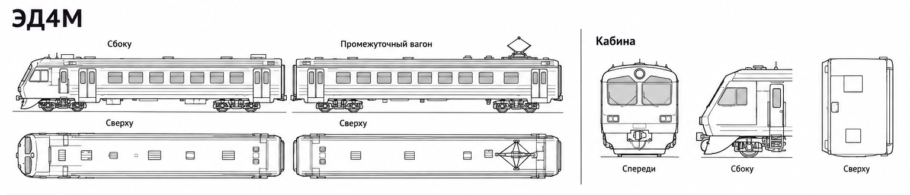
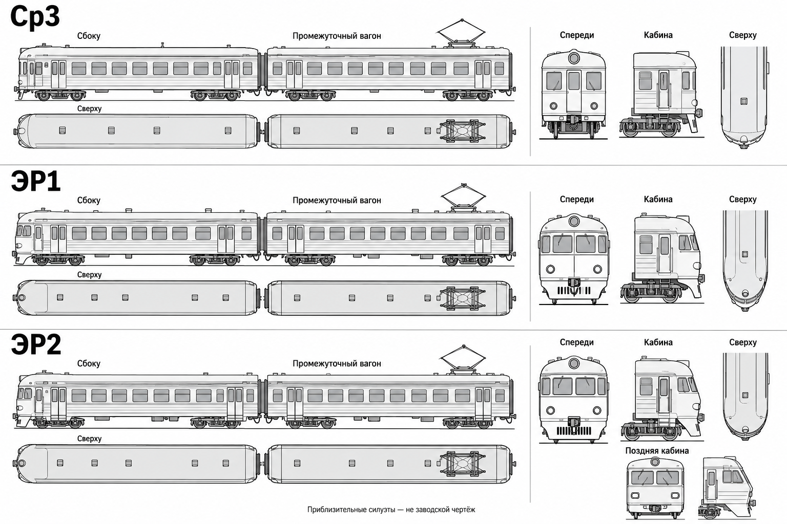
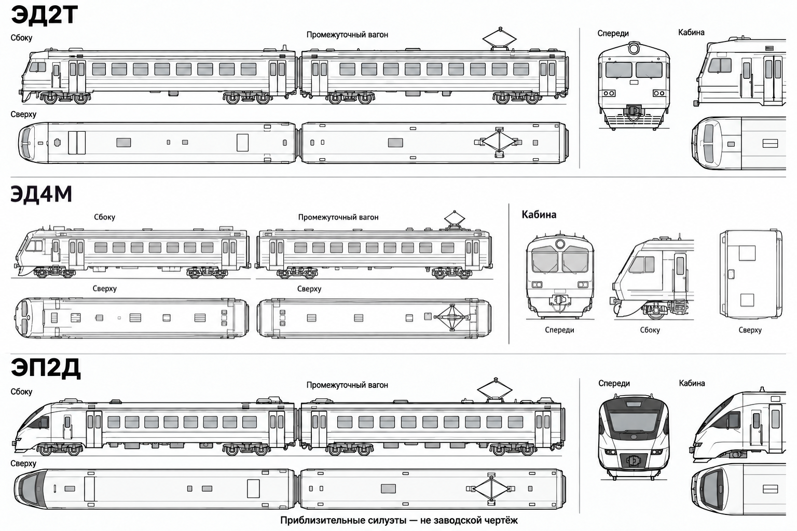
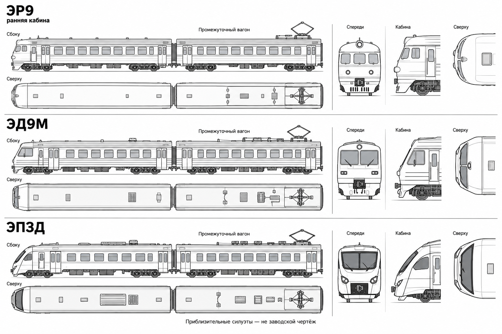
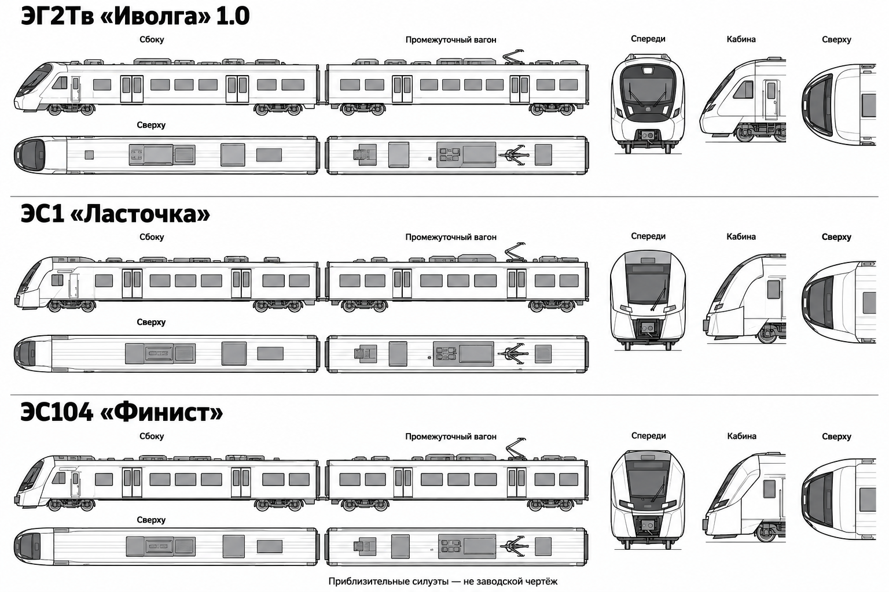
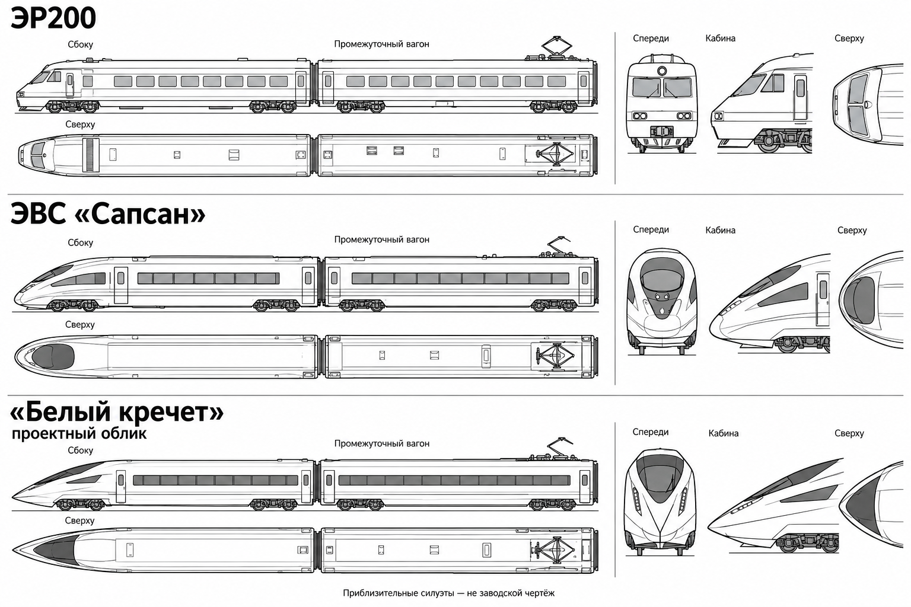

# Электропоезда — актуальные силуэтные референсы

Набор для общего облика кабин, головных и промежуточных вагонов из [дерева исследований](../../11c_railway_research_tree.md). Обновлён 1 ноября 2026 года.

Это упрощённые изображения, созданные с помощью ImageGen и отобранные в обсуждении. Они служат визуальной основой для силуэта, а не заводскими чертежами: масштаб проекций, размеры, расположение окон, дверей и оборудования не гарантированы.

## ЭД4М: какой вариант использовать

**Для ЭД4М использовать именно блок из первого варианта:** [06_ed4m-corrected.png](06_ed4m-corrected.png). Он напрямую перенесён из первого принятого изображения, без повторной генерации. В листе 02 находится тот же блок, подогнанный по высоте строки. Более поздние попытки перерисовать ЭД4М отклонены и в эту папку не включены.

## 01 — Ср3, ЭР1, ЭР2

Для ЭР2 показаны ранняя и поздняя кабины.

## 02 — ЭД2Т, ЭД4М, ЭП2Д

Блок ЭД4М заменён на первый принятый вариант.

## 03 — ЭР9, ЭД9М, ЭП3Д

ЭР9 представлен с ранней кабиной, ЭД9М — с классической кабиной.

## 04 — «Иволга», «Ласточка», «Финист»

Представители узлов дерева: ЭГ2Тв «Иволга» 1.0, ЭС1 «Ласточка», ЭС104 «Финист».

## 05 — ЭР200, «Сапсан», «Белый кречет»

«Белый кречет» изображён как приблизительный проектный облик; это не утверждение серийной геометрии.

В набор входят 15 электрических моделей. Дизельная группа ДР1, Д1, РА2 и РА3 сюда не включена.
